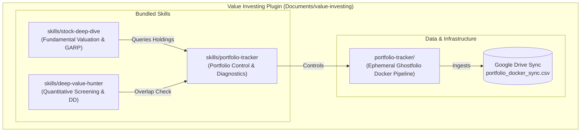

# Value Investing & Portfolio Suite (Antigravity Plugin)

> A unified, professional investment analysis and portfolio management plugin for Google Antigravity. Combines rigorous GARP valuation, quantitative deep value screening, and an ephemeral Ghostfolio Docker pipeline.

---

## 📦 What's Included



### 1. [`skills/stock-deep-dive`](./skills/stock-deep-dive)
- **Deep Fundamental Valuation**: 3-scenario financial modeling (DCF, Earnings Power Value, Net Asset Value) targeting a **10%+ annual expected return hurdle**.
- **Actionable Buy Alerts**: Explicit calculation of target buy trigger prices and margin of safety.
- **Portfolio Sizing**: Multi-currency translation, Kelly-lite position tiering (5–10% max), and sector cap enforcement (25%).

### 2. [`skills/deep-value-hunter`](./skills/deep-value-hunter)
- **Quantitative Discovery Engine**: Automated multi-gate filtering (Altman Z-score, Piotroski F-score, EV/EBIT, FCF yield, ROIC, debt ceiling).
- **Overlooked Pockets Heuristics**: Identifies spin-off orphans, post-bankruptcy emergers, fallen angels, and insider buying clusters.
- **Shortlist & Overlap Checks**: Cross-references top 20 candidates against current portfolio holdings to prevent duplicate investments or sector overconcentration.

### 3. [`skills/portfolio-tracker`](./skills/portfolio-tracker) & [`portfolio-tracker/`](./portfolio-tracker)
- **Ephemeral Ghostfolio Docker Stack**: Self-hosted Ghostfolio (PostgreSQL + Redis + Ghostfolio app) that runs completely ephemerally with zero secrets stored on disk.
- **Google Drive Sync Sidecar**: Automatically maps and imports your single source of truth (`portfolio_docker_sync.csv`).
- **Unified CLI Controller (`portfolio_ctl.py`)**: One-command status check, idempotent spin-up (`ensure`), holdings export (`--json` / markdown), and clean teardown (`cleanup`).

---

## 🚀 Installation into Antigravity

This repository is structured as an **Antigravity Plugin** (`plugin.json`).

To install and activate it globally across all Antigravity sessions:

```powershell
# From the repository root:
New-Item -ItemType Junction -Path "$HOME\.gemini\config\plugins\value-investing" -Target "$PWD"
```

Once linked, Antigravity automatically discovers the plugin and all 3 bundled skills.

---

## ⚡ Quick Start & Common Commands

### 1. Portfolio Stack Management
```bash
# Check stack health (exit code 0 if online, 1 if offline)
python skills/portfolio-tracker/scripts/portfolio_ctl.py status

# Preparation step: ensure containers are running (spins up only if down)
python skills/portfolio-tracker/scripts/portfolio_ctl.py ensure

# View current holdings summary
python skills/portfolio-tracker/scripts/portfolio_ctl.py holdings

# Teardown and wipe ephemeral containers
python skills/portfolio-tracker/scripts/portfolio_ctl.py cleanup
```

### 2. Stock Deep Dive Valuation
```bash
# Extract 5-year financials and peer multiples
python skills/stock-deep-dive/scripts/fetch_stock_data.py --ticker MSFT --output stock_digest.md

# Evaluate portfolio fit and Kelly position sizing
python skills/stock-deep-dive/scripts/portfolio_manager.py --check-ticker MSFT --price 512.0 --curr USD --markdown
```

### 3. Quantitative Deep Value Screener
```bash
# Run multi-gate screening cross-referenced with portfolio
python skills/deep-value-hunter/scripts/screen.py --check-portfolio --top 10
```

---

## 📁 Repository Layout

```
value-investing/
├── plugin.json                                # Antigravity Plugin manifest
├── README.md                                  # Plugin documentation
├── LICENSE                                    # MIT License
├── .gitignore                                 # Git ignore rules
│
├── portfolio-tracker/                         # Ephemeral Docker Pipeline
│   ├── docker-compose.yml                     # Postgres, Redis, Ghostfolio & sync-job
│   ├── start.ps1 / start.bat / start.sh       # 1-Command startup runners
│   ├── cleanup.ps1 / cleanup.bat / cleanup.sh # Ephemeral teardown runners
│   ├── .env.example                           # Configuration template
│   ├── apps-script/Code.gs                    # Google Sheet-to-Drive exporter
│   └── sync-job/                              # Ingestion sidecar (Docker & Python)
│
└── skills/                                    # Antigravity Skills
    ├── portfolio-tracker/                     # Portfolio management skill
    │   ├── SKILL.md
    │   ├── scripts/portfolio_ctl.py           # Unified CLI controller
    │   └── references/api-reference.md
    ├── stock-deep-dive/                       # Fundamental valuation skill
    │   ├── SKILL.md
    │   ├── scripts/fetch_stock_data.py
    │   ├── scripts/portfolio_manager.py
    │   ├── references/
    │   ├── prompts/
    │   └── templates/
    └── deep-value-hunter/                     # Deep value discovery skill
        ├── SKILL.md
        ├── scripts/screen.py
        ├── references/
        ├── prompts/
        └── templates/
```

---

## 🔒 Security & Privacy
- **Zero Secrets on Disk**: Database passwords and encryption salts are generated in RAM at runtime.
- **Read-Only Ingestion**: The trade CSV from Google Drive is mounted strictly read-only (`:ro`).
- **GitFarm Ready**: Pre-configured `.gitignore` ensures trade history, `.env` files, reports, and bytecode are never committed.
