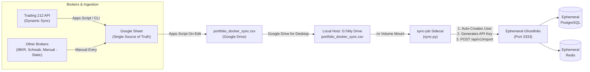

# Ephemeral Ghostfolio & Google Sheets Ingestion Pipeline

A decoupled, zero-cloud-API ingestion pipeline that turns **Ghostfolio into an on-demand ephemeral analytics engine**. The single source of truth is your Google Sheet CSV synced to Google Drive for Desktop.

---

## ⚡ 1-Command End-to-End Execution

Whenever you want to view your portfolio analytics, run one command:

```powershell
# In PowerShell (Windows):
.\start.ps1

# Or double-click / run in CMD:
start.bat
```

### What this single command does automatically:
1. **Generates ephemeral passwords in RAM**: Generates cryptographically random credentials for PostgreSQL, Redis, and Ghostfolio (`POSTGRES_PASSWORD`, `JWT_SECRET_KEY`, `ACCESS_TOKEN_SALT`). Zero secrets are written to disk.
2. **Verifies your synced trades CSV**: Directly checks `G:\My Drive\portfolio_docker_sync.csv` (or your configured `LOCAL_CSV_PATH`).
3. **Spins up the ephemeral container stack**: Launches `PostgreSQL`, `Redis`, and `Ghostfolio`.
4. **Polls readiness**: Waits until the Ghostfolio API (`/api/v1/health`) is fully initialized.
5. **Auto-provisions the user & exchanges API keys**: Automatically creates the user and default account via `POST /api/v1/user`, then exchanges the Security Token for an active Bearer API Key via `POST /api/v1/auth/anonymous`.
6. **Prints your credentials**:
   - `GHOSTFOLIO SECURITY TOKEN`: To log into the web browser UI.
   - `GHOSTFOLIO BEARER API KEY`: To make REST API calls via `curl`, Postman, or scripts.
7. **Parses & imports all trades**: The `sync-job` sidecar reads the mounted CSV (read-only), normalizes dates to UTC ISO 8601, and POSTs activities to `/api/v1/import`.
8. **Launches your default browser**: Opens `http://localhost:3333` directly to your populated portfolio.

---

## 🛑 1-Command Teardown & Ephemeral Cleanup

When you are done viewing your analytics:

```powershell
# In PowerShell (Windows):
.\cleanup.ps1

# Or double-click / run in CMD:
cleanup.bat

# For deep clean (also prunes built images and build cache):
.\cleanup.ps1 -Deep
```

### What the cleanup script destroys:
1. **Containers & Network**: Stops and removes `ghostfolio`, `postgres`, `redis`, and `sync-job`.
2. **Ephemeral Volumes**: Completely wipes PostgreSQL database storage and Redis cache (`docker compose down -v`).
3. **Lingering Docker Volumes**: Checks for and deletes any untracked project volumes.
4. **Local Temp Files & Cache**: Cleans up Python bytecode (`__pycache__`), temporary files, and logs.
5. **(Optional `-Deep`)**: Removes the built Docker sidecar image and builder cache.

**Your single source of truth remains completely safe in your Google Drive CSV.**

---

## 🏛 Architecture & Data Flow



---

## 🔄 Dynamic Broker Sync (Trading 212) & Multi-Broker Support

The Google Sheet operates as a single hybrid ledger for both **dynamic** (API-connected) and **static** (non-API) broker accounts:

### 1. Data Model & Column Structure
The first tab of your Google Sheet supports the following columns:

| Column | Name | Format / Example | Description |
| :---: | :--- | :--- | :--- |
| **A** | `Date` | `2026-10-01` | Execution date (ISO YYYY-MM-DD) |
| **B** | `Type` | `BUY` or `SELL` | Transaction type |
| **C** | `Symbol` | `AAPL`, `MSFT`, `VIE.PA` | Standard ticker symbol |
| **D** | `Quantity` | `10.5` | Executed share count |
| **E** | `UnitPrice` | `150.25` | Price per share in asset currency |
| **F** | `Currency` | `USD`, `EUR`, `GBP`, `AUD` | Trade currency |
| **G** | `Fee` | `0.00` | Brokerage or transaction fees |
| **H** | `Broker` | `Trading212`, `IBKR`, `Schwab`, `Manual` | Identifies broker source |
| **I** | `OrderId` | `184729104` | Broker execution ID (prevents duplicates) |

> [!IMPORTANT]
> **Dynamic vs. Static Isolation**: Only rows where `Broker == 'Trading212'` are dynamically synchronized. All other rows (e.g. `Broker == 'IBKR'`, `Broker == 'Manual'`) are **STATIC** and will never be overwritten, modified, or deleted by the automated sync.

### 2. Google Apps Script Automated Sync
In your Google Sheet, open `Extensions` -> `Apps Script` and paste [`portfolio-tracker/apps-script/Code.gs`](./apps-script/Code.gs):
- **Set API Key**: Click `📊 Ghostfolio Sync` -> `⚙️ Set Trading 212 API Key`. Key is stored securely in Google User Properties (never stored in cells or code).
- **Run Sync**: Click `📊 Ghostfolio Sync` -> `📥 Sync Trading 212 Trades (Dynamic)`. Fetches filled orders, appends only new executions, and automatically updates the Drive CSV.
- **Automated Timer (Optional)**: In Apps Script, set a time-driven trigger for `syncTrading212Orders` (e.g., daily or hourly) for 100% hands-free cloud synchronization.

### 3. Local Python CLI Sync (`sync_trading212.py`)
You can also preview and sync trades directly from your terminal:
```bash
# Preview recent executed orders in table format
python portfolio-tracker/scripts/sync_trading212.py --api-key <YOUR_KEY>

# Append new executed trades directly into local CSV
python portfolio-tracker/scripts/sync_trading212.py --api-key <YOUR_KEY> --output-csv "G:\My Drive\portfolio_docker_sync.csv"
```

---

## 📁 Repository Structure

```
portfolio-tracker/
├── start.ps1 / start.bat / start.sh       # 1-Command end-to-end runners
├── cleanup.ps1 / cleanup.bat / cleanup.sh # Ephemeral teardown & storage wipe
├── docker-compose.yml                     # Ephemeral stack orchestration
├── .env.example                           # Configuration template
├── .gitignore                             # Git ignore rules (protects data & local files)
├── apps-script/
│   └── Code.gs                            # (Already deployed) Sheet-to-Drive CSV exporter
├── sync-job/
│   ├── Dockerfile                         # Lightweight Python 3.11 container
│   ├── requirements.txt                   # requests, python-dateutil
│   └── sync.py                            # Auto-provisioning, key generation & CSV ingestion
└── skills/
    └── portfolio-tracker/                 # Built-in Antigravity Agent Skill
        ├── SKILL.md                       # Skill definition & runbook
        ├── scripts/
        │   └── portfolio_ctl.py           # Unified cross-platform CLI controller
        └── references/
            └── api-reference.md           # Ghostfolio endpoints & schema reference
```

---

## 🤖 Antigravity AI Agent Skill (`portfolio-tracker`)

This repository ships with a native **Antigravity AI Agent Skill** under `skills/portfolio-tracker/`. It exposes the pipeline to pair programming agents (`stock-deep-dive`, `deep-value-hunter`) through a unified CLI controller:

```bash
# Check if container stack is healthy
python skills/portfolio-tracker/scripts/portfolio_ctl.py status

# Preparation step: ensure containers are running (spins up only if down)
python skills/portfolio-tracker/scripts/portfolio_ctl.py ensure

# Fetch current holdings table or structured JSON
python skills/portfolio-tracker/scripts/portfolio_ctl.py holdings
python skills/portfolio-tracker/scripts/portfolio_ctl.py holdings --json

# Stop and wipe ephemeral stack
python skills/portfolio-tracker/scripts/portfolio_ctl.py cleanup
```

---

## 🧪 Testing Dry-Run

You can verify the CSV parsing and see simulated credentials without starting Docker:

```powershell
.\start.ps1 -DryRun
```
