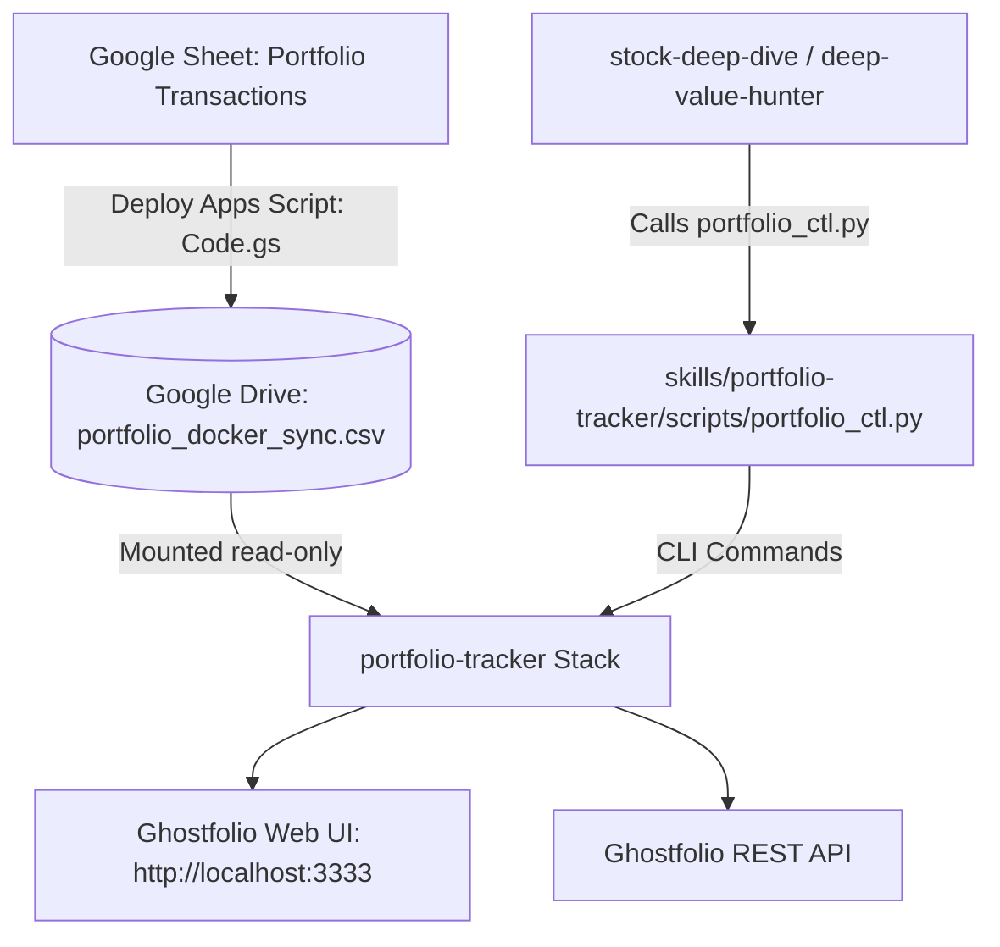

# Portfolio Tracker (Ghostfolio Ephemeral Pipeline)

> Self-hosted, ephemeral Ghostfolio portfolio stack synchronized from Google Drive CSV (`portfolio_docker_sync.csv`). Serves as the central portfolio data service for Antigravity investment skills.

---

## Architecture & Lifecycle



- **Source of Truth**: Google Drive CSV (`G:\My Drive\portfolio_docker_sync.csv`).
- **Storage**: Ephemeral Docker containers (PostgreSQL, Redis, Ghostfolio, sync-job). Zero persistent secrets on disk.
- **Controller**: `scripts/portfolio_ctl.py` provides an idempotent, cross-platform CLI interface.

---

## CLI Control Commands

All operations are encapsulated in `scripts/portfolio_ctl.py`:

### 1. Check Container Stack Status
```bash
python scripts/portfolio_ctl.py status
```
- Returns exit code `0` and `ONLINE (http://localhost:3333)` if healthy.
- Returns exit code `1` and `OFFLINE` if containers are not running.

### 2. Preparation Step (Ensure Running)
```bash
python scripts/portfolio_ctl.py ensure
```
- **If ALREADY ONLINE**: Does nothing and exits immediately (`[OK] Ghostfolio stack is ALREADY RUNNING`).
- **If OFFLINE**: Automatically runs the startup runner (`start.ps1` on Windows / `start.sh` on POSIX), waits for Ghostfolio HTTP readiness, executes trade ingestion, and opens `http://localhost:3333`.

### 3. Retrieve Current Holdings
```bash
# Markdown table output
python scripts/portfolio_ctl.py holdings

# Structured JSON output
python scripts/portfolio_ctl.py holdings --json

# Comma-separated ticker list
python scripts/portfolio_ctl.py holdings --symbols-only
```

### 4. Explicit Start & Teardown
```bash
# Manual spin-up
python scripts/portfolio_ctl.py start

# Teardown and wipe ephemeral storage
python scripts/portfolio_ctl.py cleanup
```

---

## Sibling Skill Integration Protocol

When sibling analytical skills (`stock-deep-dive`, `deep-value-hunter`, rebalancing engines) require portfolio context:

1. **Run the Preparation Step**:
   Execute `python <repo_or_skill_path>/scripts/portfolio_ctl.py ensure` to ensure the Ghostfolio stack is running and healthy.
2. **Fetch Enriched Portfolio Data**:
   Execute `python <repo_or_skill_path>/scripts/portfolio_ctl.py holdings --json` to inspect:
   - Existing asset symbols (to avoid duplicate recommendations)
   - Estimated book values, positions, and current weights
   - Total portfolio size, performance, and overall gains
3. **Sector & Sizing Fit**:
   Use portfolio values to enforce maximum sector ceilings (25%) and calculate exact dollar commitments for Kelly-lite position sizing.
4. **Post-Analysis Teardown (Optional)**:
   When the user completes their investment session, run `python <repo_or_skill_path>/scripts/portfolio_ctl.py cleanup` if they wish to shut down the containers.

---

## Repository Directory Layout

```
portfolio-tracker/
├── start.ps1 / start.bat / start.sh       # Native platform startup runners
├── cleanup.ps1 / cleanup.bat / cleanup.sh # Ephemeral teardown runners
├── docker-compose.yml                     # Postgres, Redis, Ghostfolio & sync-job
├── README.md                              # Repository documentation
├── apps-script/
│   └── Code.gs                            # Google Apps Script Drive exporter
├── sync-job/
│   ├── Dockerfile                         # Python sync sidecar image
│   ├── requirements.txt                   # Requests & dateutil
│   └── sync.py                            # Auto-provisioning & trade importer
└── skills/
    └── portfolio-tracker/
        ├── SKILL.md                       # This skill definition
        ├── scripts/
        │   └── portfolio_ctl.py           # Unified CLI controller
        └── references/
            └── api-reference.md           # Ghostfolio endpoints & schema
```
