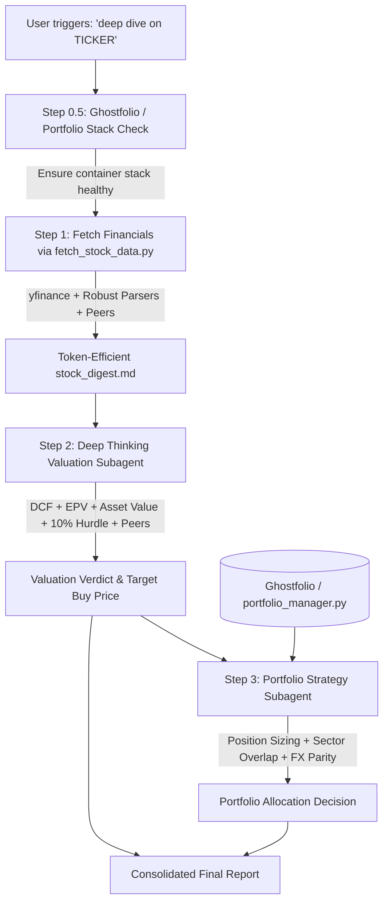

# Stock Deep Dive & Portfolio Allocation Pipeline

> A rigorous 3-step fundamental valuation and portfolio allocation engine for Value Investing and Growth at a Reasonable Price (GARP) practitioners.

---

## 🏛 Core Investment Philosophy

1. **Data over Market Sentiment**: Rely primarily on audited filings, balance sheets, cash flows, and normalized earnings power.
2. **Strict Hurdle Rate**: Every thesis must demonstrate a credible path to **at least 10% annual expected return (CAGR / IRR)**.
3. **Explicit Margin of Safety**: Price is what you pay; value is what you get. Never issue a Buy without a quantified margin of safety against probability-weighted fair value.
4. **Actionable Buy Alerts**: If a company is currently fairly valued or overvalued (Hold/Pass), compute the exact **Target Buy Alert Price** needed to achieve our hurdle rate and margin of safety.
5. **Portfolio Contextualization**: Sizing and risk are relative to what you already own. Evaluates sector concentration (25% cap), factor overlap, cross-currency parity, and position sizing.

---

## ⚡ 3-Step Execution Workflow



---

## 🛠 Command-Line Tools

### 1. Financial Statement Extractor (`fetch_stock_data.py`)
Fetches 5-year financials, multiples, and peer benchmarks:
```bash
python scripts/fetch_stock_data.py --ticker MSFT --output stock_digest.md
```

### 2. Portfolio Manager (`portfolio_manager.py`)
Evaluates portfolio fit, sector allocations, and candidate cross-referencing:
```bash
# Check candidate fit and print portfolio markdown
python scripts/portfolio_manager.py --check-ticker MSFT --price 512.0 --curr USD --markdown

# Inspect portfolio from Google Drive synced CSV
python scripts/portfolio_manager.py --csv "G:/My Drive/portfolio_docker_sync.csv" --markdown

# Check Ghostfolio container status
python scripts/portfolio_manager.py --ghostfolio-status
```

---

## 📁 Repository Structure

```
stock-deep-dive/
├── SKILL.md                                 # Antigravity skill definition & runbook
├── README.md                                # Repository documentation
├── LICENSE                                  # MIT License
├── .gitignore                               # Git ignore rules
├── scripts/
│   ├── fetch_stock_data.py                  # Financial statement & valuation data extractor
│   └── portfolio_manager.py                 # Multi-currency portfolio diagnostic & Kelly sizing
├── references/
│   ├── valuation-framework.md               # DCF, EPV, Asset Value, 10%+ CAGR & Buy Alert formulas
│   ├── garp-value-gates.md                  # Moat analysis, ROIC, Capital Allocation, Value Traps
│   └── portfolio-allocation-rules.md        # Kelly-lite sizing, sector limits, correlation rules
├── prompts/
│   ├── step2-deep-valuation-agent.md        # Deep thinking valuation subagent prompt
│   └── step3-portfolio-agent.md             # Portfolio fit & allocation subagent prompt
└── templates/
    ├── stock-deep-dive-report.md            # Final unified report markdown skeleton
    └── portfolio-default.md                 # Default starter portfolio schema
```

---

## 🚀 Antigravity Skill Integration

This repository serves as a self-contained Antigravity Agent Skill. When placed in your workspace or linked to `~/.gemini/config/skills/stock-deep-dive`, the agent automatically activates this pipeline when you prompt:
- *"deep dive on $TICKER"*
- *"analyze $TICKER"*
- *"/stock-deep-dive"*
- *"evaluate $TICKER for my portfolio"*
