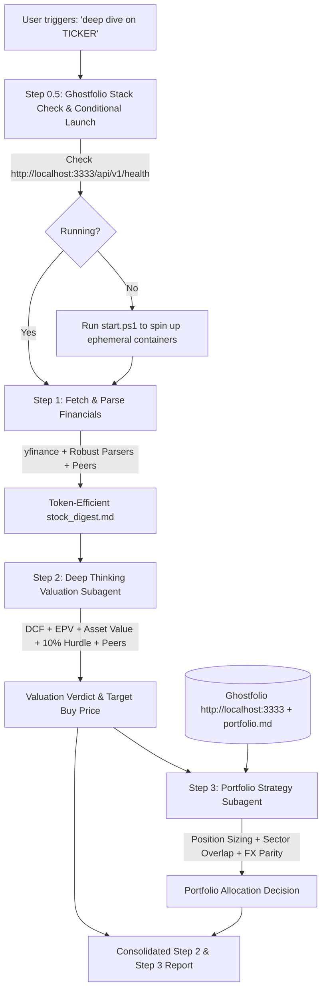

# Stock Deep Dive & Portfolio Allocation Pipeline

> A rigorous 3-step fundamental valuation and portfolio fit engine designed for Value Investing and Growth at a Reasonable Price (GARP) practitioners.

## Core Philosophy
1. **Data over Market Sentiment**: Rely primarily on audited filings, balance sheets, cash flows, and normalized earnings power. If sentiment aligns with data, ride the trend; if sentiment diverges, trust the numbers.
2. **Strict Hurdle Rate**: Every thesis must demonstrate a credible path to **at least 10% annual expected return (CAGR / IRR)**.
3. **Explicit Margin of Safety**: Price is what you pay; value is what you get. Never issue a Buy without a quantified margin of safety against probability-weighted fair value.
4. **Actionable Buy Alerts**: If a great company is currently fairly valued or overvalued (Hold/Pass), compute the exact **Target Buy Alert Price** needed to achieve our hurdle rate and margin of safety.
5. **Portfolio Contextualization**: Sizing and risk are relative to what you already own. Evaluate sector concentration, factor overlap, cross-currency parity, and position sizing.

---

## 3-Step Execution Workflow



### Step 0: Ticker Resolution & Input Handling
- **If no ticker or company name is provided** (e.g. user just triggers `/stock-deep-dive` or "deep dive"):
  - **CRITICAL**: Do NOT execute any PowerShell/shell commands, do NOT inspect previous conversation logs, and do NOT search filesystem history.
  - Immediately ask the user in plain chat to provide the ticker symbol or company name they wish to analyze.
- **If the user provides a company name** (e.g., "Veolia") instead of a specific ticker symbol:
  - Do NOT write inline Python scripts or run shell commands to guess tickers.
  - Use a web search to find the correct primary exchange ticker or US ADR, or check the tickers listed in `portfolio.md`.

### Step 0.5: Portfolio Container Stack Preparation (Conditional Launch)
Before running portfolio fit analysis, ensure the self-hosted Ghostfolio container pipeline is active to provide real-time portfolio holdings, trade history, and cash context using the dedicated `portfolio-tracker` skill:

1. **Check & Ensure Running (Idempotent 1-Command)**:
   ```bash
   python C:/Users/aleks/.gemini/config/skills/portfolio-tracker/scripts/portfolio_ctl.py ensure
   ```
   - **If ALREADY ONLINE**: Skips launch and outputs `[OK] Ghostfolio stack is ALREADY RUNNING`.
   - **If OFFLINE / DOWN**: Automatically executes the startup sequence, ingests Google Drive synced trades (`G:\My Drive\portfolio_docker_sync.csv`), and opens `http://localhost:3333`.
   - **Fallback**: If Docker Desktop is offline, `portfolio_manager.py` gracefully falls back to reading `G:\My Drive\portfolio_docker_sync.csv` or `portfolio.md`.

2. **Optional Teardown**: When the user finishes their portfolio review session, the ephemeral stack can be stopped and wiped using:
   ```bash
   python C:/Users/aleks/.gemini/config/skills/portfolio-tracker/scripts/portfolio_ctl.py cleanup
   ```

### Step 1: Gather Data & Generate Token-Efficient Digest
**CRITICAL RULE**: Do NOT write custom inline python scripts or use raw `yfinance` commands to fetch data. You MUST use the pre-built extractor script directly as an executable:

```bash
C:/Users/aleks/.gemini/config/skills/stock-deep-dive/scripts/fetch_stock_data.py --ticker <TICKER> --output C:/Users/aleks/.gemini/antigravity/scratch/stock_digest.md
```
The extractor features:
- **Robust CapEx & FCF Extraction**: Automatically resolves US GAAP and European/IFRS concession reporting structures.
- **Native Currency & Formatting**: Displays accurate currency symbols and numbers (€, $, £, A$, etc.).
- **Peer Valuation Snapshot & Sector WACC**: Evaluates candidate multiples against representative industry peers and sector cost-of-capital ranges.

### Step 2: Deep Thinking Valuation Subagent
Invoke a dedicated thinking subagent:
- **TypeName**: `self`
- **Role**: `Deep Stock Valuation Analyst`
- **Model**: `pro` (or inherited thinking model)
- **Prompt Reference**: Load instructions from `prompts/step2-deep-valuation-agent.md` and reference `references/valuation-framework.md` & `references/garp-value-gates.md`.
- **Outputs**:
  - Circle of competence & business model breakdown
  - Moat & competitive advantage scoring (1–10)
  - 3-Scenario valuation (Bull, Base, Bear) using DCF, Earnings Power Value (EPV), and Net Asset Value
  - Probability-weighted Intrinsic Fair Value & Margin of Safety %
  - Relative peer multiples check and sector WACC comparison
  - Expected 3-5 Year CAGR (Targeting >= 10%/yr)
  - **Verdict**: **BUY**, **HOLD**, or **SELL**
  - **Actionable Buy Target Price** (if not Buy, calculate the trigger price for notification setup)
  - 10-point Value Trap Red Flags checklist

### Step 3: Portfolio Fit Analysis Subagent
**CRITICAL RULE**: Do NOT write inline python scripts to import `portfolio_manager` functions. You MUST generate the portfolio context by running the executable script directly:
```bash
C:/Users/aleks/.gemini/config/skills/stock-deep-dive/scripts/portfolio_manager.py --check-ticker <TICKER> --price <PRICE> --curr <CURR> --markdown
```
*(Optional: If analyzing synced trades directly from Google Drive, add `--csv "G:/My Drive/portfolio_docker_sync.csv"`. To verify container status, check `http://localhost:3333` or `--ghostfolio-status`).*

Pass the output of this command, along with the Step 2 Valuation Summary, to the portfolio strategy subagent:
- **TypeName**: `self`
- **Role**: `Portfolio Strategy Analyst`
- **Model**: `inherit` or `flash`
- **Prompt Reference**: Load instructions from `prompts/step3-portfolio-agent.md` and reference `references/portfolio-allocation-rules.md`.
- **Inputs**: Step 2 Valuation Summary + the markdown output from the CLI command above (reflecting Ghostfolio / synced portfolio context).
- **Outputs**:
  - Current portfolio structure & cash reserve overview (with FX normalization)
  - Cross-ticker matching with existing portfolio positions
  - Sector/industry concentration impact
  - Factor overlap (Value vs Growth, Cyclical vs Defensive)
  - Recommended position sizing (Kelly-lite capped at 5-10%)
  - Portfolio action verdict: *Immediate Allocation*, *Starter Position / Hold*, *Queue Buy Alert*, *Swap/Replace Holding*, or *Pass (Overconcentration)*.

### Step 4: Final Consolidated Output
Present the unified markdown report covering Step 2 (Deep Dive Valuation & Buy Alert Price) and Step 3 (Portfolio Allocation & Fit) in chat and save to the reports directory using `templates/stock-deep-dive-report.md`.

---

## Lazy-Loading Protocol (Token Optimization)
To prevent context overflow, load reference files strictly when needed:
- **Step 1**: Execute script `scripts/fetch_stock_data.py`. Do NOT load raw tables into parent context.
- **Step 2**: The subagent reads `prompts/step2-deep-valuation-agent.md`, `references/valuation-framework.md`, `references/garp-value-gates.md`, and `stock_digest.md`.
- **Step 3**: The subagent reads `prompts/step3-portfolio-agent.md`, `references/portfolio-allocation-rules.md`, and the portfolio file.
- **Step 4**: Synthesize final findings using `templates/stock-deep-dive-report.md`.

---

## Directory Structure
```
stock-deep-dive/
├── SKILL.md                                 # Skill definition & runbook
├── scripts/
│   ├── fetch_stock_data.py                  # Yahoo Finance & financial statement extractor (w/ CapEx & Peers)
│   └── portfolio_manager.py                 # Portfolio loader, FX converter, and risk calculator
├── references/
│   ├── valuation-framework.md               # DCF, EPV, Asset Value, 10%+ CAGR & Buy Alert formulas
│   ├── garp-value-gates.md                  # Moat analysis, ROIC, Capital Allocation, Value Traps
│   └── portfolio-allocation-rules.md        # Kelly-lite sizing, sector limits, correlation rules
├── prompts/
│   ├── step2-deep-valuation-agent.md        # Valuation subagent prompt
│   └── step3-portfolio-agent.md             # Portfolio fit subagent prompt
└── templates/
    ├── stock-deep-dive-report.md            # Final unified report markdown skeleton
    └── portfolio-default.md                 # Default schema for user portfolio
```
